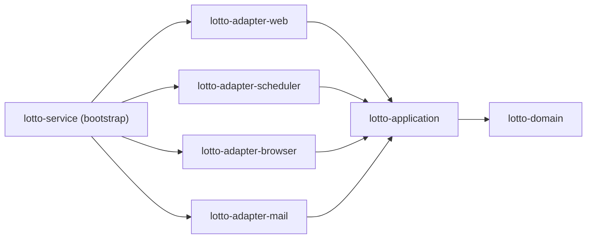

# Lotto Service Clean Architecture

Kotlin + Gradle 멀티모듈 구성이다. 레이어 의존 방향은 각 모듈의 `build.gradle` 선언이 강제한다(어댑터끼리는 서로 의존할 수 없다).

## 모듈

```text
lotto-service (루트: 실행 앱)            bootJar/bootBuildImage, version, buildInfo
│   LottoServiceApplication             @SpringBootApplication (패키지 org.nowstart.lotto)
│   config/LottoProperties              lotto.* 설정 (키 이름 유지)
│   config/ApplicationConfig            LottoProperties → ExecutionSettings·BrowserSettings, Clock, 달력, 실행기
│   adapter/outbound/properties         LoadLottoUsersPort 구현 (설정의 사용자 목록)
│
├─ lotto-domain                         순수 Kotlin (프레임워크 의존 없음)
│     type/                             ExecutionStatus, MessageType, StepType, TaskMode, TriggerType
│     exception/                        LottoAutomationException, NotificationSendException, LedgerUnreadableException
│     calendar/LottoDrawCalendar        회차(1회차 2002-12-07, 주 단위)·판매 시간(06~24시, 토 20시 마감)
│     ledger/                           LedgerEntry, LedgerMath, PurchasePlan, Won (구매 수량 계산)
│
├─ lotto-application                    api(lotto-domain), spring-context
│     port/inbound/                     LottoUseCase, InitializeLottoUseCase, TargetCommand, LottoExecution
│     port/outbound/                    LottoAutomationPort(+세션·원장 값), SendNotificationPort, LoadLottoUsersPort
│     service/                          LottoInteractor, LottoUserAsyncRunner, LottoPurchaseProcedure,
│                                       PurchaseOutcome, UncertainPurchaseRegistry, LottoNotificationFactory
│
├─ lotto-adapter-web                    LottoManualController (POST /api/lotto/check, /buy)
├─ lotto-adapter-scheduler              크론 스케줄러, 기동 초기화 러너
├─ lotto-adapter-browser                Playwright: 세션·트레이스·로그인·구매·원장 판독
└─ lotto-adapter-mail                   메일 발송, SMTP 실패 분류, 재발송 대기열(outbox)
```

## 의존 방향



## 구매 흐름 (멱등)

1. `LottoPurchaseProcedure.precheck`: 판매 시간 밖이거나 같은 (계정, 회차)가 판정 대기 중이면 브라우저를 열지 않는다.
2. 로그인 → 원장을 fail-closed로 읽는다(행도 빈 결과 표시도 없으면 판독 불가 → 구매하지 않음).
3. `PurchasePlan`: `min(count, 5) - 이번 회차 구매 수량`만 산다. 0이면 "이미 구매됨".
4. 확정 클릭 뒤에는 원장 새 행(클릭 전후 비교)·예치금 차감·클릭 후 거부 문구만으로 결과를 정한다.
   그 외(클릭 후 예외 포함)는 `Uncertain`이며 `UncertainPurchaseRegistry`가 10분간 같은 회차 재구매를 막는다.

## 원칙

- 설정은 루트의 `LottoProperties` 한 곳에서 읽고, 모듈에는 설정 레코드(`ExecutionSettings`, `BrowserSettings`)만 넘긴다.
- 사이트 규칙(판매 시간, 회차, 원장 반영 지연, 재발송 간격)은 설정이 아니라 코드 상수다.
- 패키지명은 `org.nowstart.lotto.*`로 통일해 루트의 컴포넌트 스캔이 모든 모듈을 찾는다. `in`은 Kotlin 예약어라 `inbound`/`outbound`를 쓴다.
