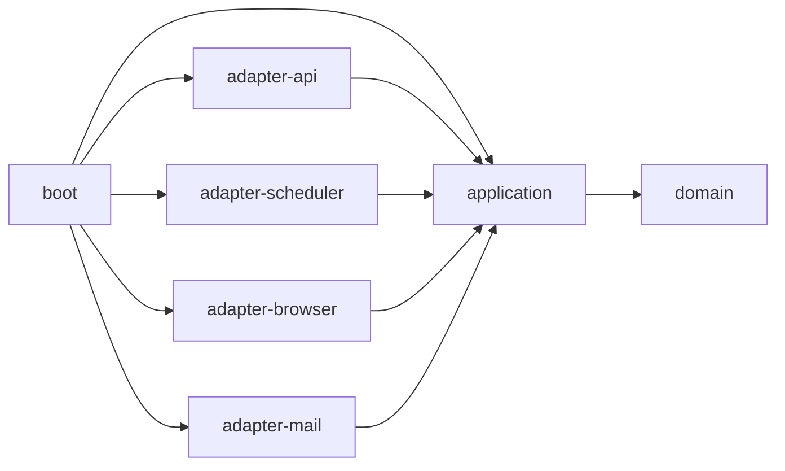

# Lotto Service Clean Architecture

Kotlin + Gradle 멀티모듈 구성이다. 레이어 의존 방향은 각 모듈의 `build.gradle` 선언이 강제한다(어댑터끼리는 서로 의존할 수 없다).

## 모듈

```text
lotto-service                           Gradle 모듈 구성, 공통 빌드 설정과 버전
├─ boot                                 Spring Boot 실행 앱
│     Application                       @SpringBootApplication (패키지 org.nowstart.lotto)
│     config/AutomationProperties       lotto.* 설정
│     config/ApplicationConfig          BrowserSettings, Clock, 달력, 가상 스레드 실행기
│     adapter/outbound/properties       LoadUsersPort 구현 (설정의 사용자 목록)
│     src/main/resources/               application.yaml, application-local.yaml
│     src/test/kotlin/                  ApplicationContextTest (모듈 간 빈 연결 검증)
│
├─ domain                               순수 Kotlin (프레임워크 의존 없음)
│     type/                             ExecutionStatus, MessageType, StepType, TaskMode, TriggerType
│     exception/                        AutomationException, NotificationSendException, LedgerUnreadableException
│     calendar/DrawCalendar             회차(1회차 2002-12-07, 주 단위)·판매 시간(06~24시, 토 20시 마감)
│     ledger/                           TicketResult, LedgerEntry, LedgerMath, PurchasePlan, PurchaseConfirmation, Won
│
├─ application                          api(domain), spring-context
│     port/inbound/                     JobUseCase, InitializeUseCase, TargetCommand, StartResult, ExecutionView
│     port/outbound/                    AutomationPort(+세션·원장 값), SendNotificationPort, LoadUsersPort
│     service/                          JobService, AttemptRunner, AccountLocks, PurchaseProcedure,
│                                       PurchaseOutcome, UncertainPurchaseRegistry, JobNotifier, NotificationFactory
│
├─ adapter-api                          ManualController (구매·결과 확인 작업 시작, 실행 상태 조회)
├─ adapter-scheduler                    크론 스케줄러, 기동 초기화 러너
├─ adapter-browser                      Playwright: 세션·트레이스·로그인·구매·원장 판독
└─ adapter-mail                         메일 발송, SMTP 실패 분류, 재발송 대기열(outbox)
```

## 의존 방향



## 구매 흐름 (멱등)

1. `JobService`가 계정별로 구매할 회차와 마감 시각을 기록한다. 작업이 계정 잠금을 얻으면 `AttemptRunner`가 한 번의 시도를 수행한다.
2. `PurchaseProcedure.precheck`가 판매 시간과 같은 계정·회차의 구매 보류 여부를 확인한다. 보류 중이면 브라우저를 열기 전에 다음 시도를 예약한다.
3. 로그인 후 원장을 읽고 `min(count, 5) - 이번 회차 구매 수량`만 산다. 원장을 읽을 수 없으면 결제하지 않는다. 이미 목표 수량을 채웠으면 기존 티켓으로 결과를 알린다.
4. 최종 확정 직전에 대상 회차와 판매 시간을 다시 확인한다. 클릭 후에는 브라우저 어댑터가 사이트의 거부 메시지를 식별하고, 구매 절차가 원장과 잔액을 조회한다. `PurchasePlan`은 대상 회차의 새 원장 행, 구매액 이상의 예치금 차감, 사이트 거부 순으로 증거를 평가한다.
5. 클릭 후 결과가 불확실하면 `UncertainPurchaseRegistry`가 10분간 재구매를 막는다. 기한 안에 재시도할 수 있으면 새 세션에서 원장을 다시 읽는다.

## 원칙

- `TicketResult`와 `PurchasePlan`은 구매 규칙에 쓰이는 도메인 값이다. 포트는 이 타입들을 직접 사용할 수 있다. `ExecutionView`는 실행 조회 결과를, `PurchaseSubmission`은 브라우저가 관찰한 클릭 상태와 거부 메시지를 표현하므로 각 포트에 둔다.
- `boot` 모듈의 `AutomationProperties`에서 읽은 브라우저 설정은 `BrowserSettings`로, 계정 목록은 `LoadUsersPort`로 전달한다.
- 사이트 규칙(판매 시간, 회차, 원장 반영 지연, 재발송 간격)은 설정이 아니라 코드 상수다.
- `boot` 모듈의 `Application`은 `org.nowstart.lotto` 패키지에서 모든 모듈의 컴포넌트를 스캔한다. `in`은 Kotlin 예약어라 `inbound`/`outbound`를 쓴다.
